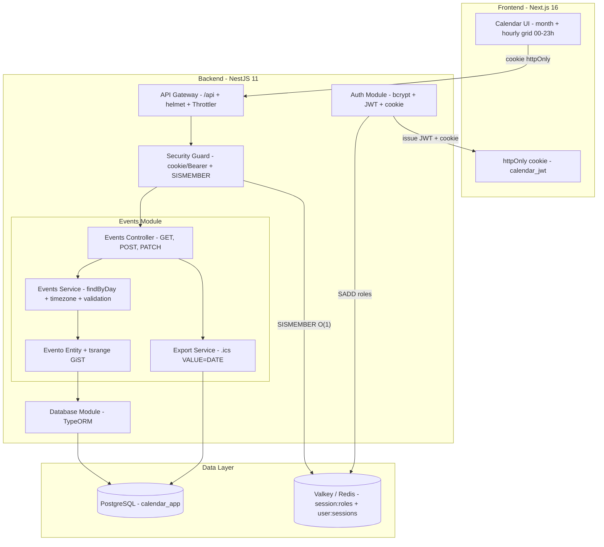

# 📅 Nexus Calendar App

<p align="center">
  
  
  
  
  
</p>

Secure calendar app with JWT, RBAC, and O(1) session checks via Valkey Sets. NestJS + Next.js.

## Features

- Monthly calendar + hourly grid (00–23h) in the day sidebar
- Multiple events per day, each in its own hour slot
- All-day events (`diaInteiro=true`, handled as a pure date end-to-end)
- `.ics` export (download or email for mobile import, all-day uses `VALUE=DATE`)
- Fail-closed sessions: Valkey down → `503`, never silent local-memory auth

## Hourly grid

The day sidebar shows every hour as a clickable slot. Click one to open the new-event modal pre-filled (e.g. `09:00 → 10:00`); click an occupied slot to add another event at that hour.

- No `UNIQUE(user, day)` — multi-event days are the norm.
- `dataFim` must be after `dataInicio`, otherwise `400`.
- DB remodel (`1793979730000-RemodelEventosHorarios`): `CHECK(data_fim >= data_inicio)` + indexes on `(data_inicio, data_fim)` and `(usuario_id, data_inicio, data_fim)`; plus a `tsrange` GiST index for overlap queries (`1793980000000-TstzRangeEvento`).
- Timezone: `APP_TIMEZONE=America/Sao_Paulo` defines day boundaries; `?data=2026-11-09` means midnight in that zone (DST-safe). `diaInteiro` is stored as the whole local day and exported as `VALUE=DATE` (exclusive end).
- Day filter uses overlap: `dataInicio <= endOfDay AND dataFim >= startOfDay`.

```http
GET  /api/events                 # all events (or ?mes=11&ano=2026)
GET  /api/events?data=2026-11-09 # one day (hourly grid)
POST /api/events                 # ADMIN only
```

```jsonc
{ "title": "Meeting 09h", "titulo": "Meeting 09h",
  "dataInicio": "2026-11-09T09:00:00.000Z",
  "dataFim": "2026-11-09T10:00:00.000Z", "diaInteiro": false }
```

## Architecture



## Security (Valkey Set strategy)

- Login stores roles with `SADD session:roles:<userId>:<jti>` (+ `user:sessions:<userId>` index); the guard checks `SISMEMBER` in O(1). Key TTL equals JWT TTL.
- **Fail-closed:** if Valkey is down, protected routes return `503` (not `401`/`403`). The in-memory fallback exists only when `VALKEY_ALLOW_MEMORY_FALLBACK=true` (local dev/tests).
- Token travels as an `httpOnly + SameSite=Lax` cookie (`calendar_jwt`, never `localStorage`); Bearer is still accepted for API clients. `GET /auth/me` restores the session on reload. CORS is restricted to `CORS_ORIGINS`, helmet is on, and login is throttled (5/min, IP).
- `USER` reads events; `ADMIN` manages events. Each JWT has a unique `jti`; logout deletes the session set, revoking access instantly (OWASP A01/A07). `POST /auth/logout` also clears the cookie.

## Tech Stack

| Layer | Tech |
|---|---|
| Backend | NestJS 11, TypeScript, PostgreSQL 17 + TypeORM, Valkey (`ioredis`), JWT + bcrypt, Jest |
| Frontend | Next.js 16, React 19, Tailwind v4, Lucide |

## Quickstart

```powershell
# 1. Database (PostgreSQL 5434, calendar_app)
powershell -ExecutionPolicy Bypass -File .\scripts\start-postgres.ps1
copy backend\.env.example backend\.env   # DB_HOST, DB_PORT=5434, DB_PASSWORD=postgres

# 2. Backend (http://localhost:5000/api)
#    No Valkey locally? enable the dev-only fallback:
#    $env:VALKEY_ALLOW_MEMORY_FALLBACK='true'; node dist/main
cd backend; npm install; npm run migration:run; npm run start:dev

# 3. Frontend (http://localhost:3000)
cd frontend; npm install; npm run dev
```

| Profile | Email | Password | Roles |
|---|---|---|---|
| Admin | `admin@calendar.com` | `admin123` | `ADMIN`, `USER` |
| User | `user@calendar.com` | `user123` | `USER` |

## Tests

```bash
cd backend; npm test

# hourly check: two events on the same day + ?data filter
curl -s -X POST http://localhost:5000/api/events -H "Authorization: Bearer <TOKEN>" \
  -H 'Content-Type: application/json' \
  -d '{"title":"Meeting 09h","dataInicio":"2026-11-09T09:00:00.000Z","dataFim":"2026-11-09T10:00:00.000Z","diaInteiro":false}'
curl -s "http://localhost:5000/api/events?data=2026-11-09" -H "Authorization: Bearer <TOKEN>"
```

Built with NestJS + Next.js + Valkey for secure, fast calendar access control.
