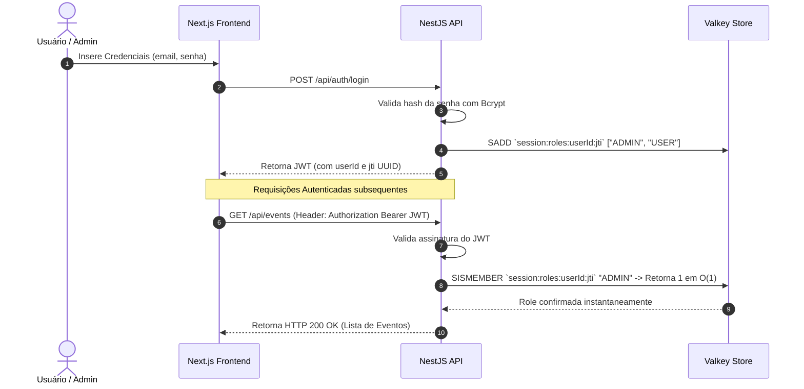

# 📅 Nexus Calendar App - Valkey O(1) Set Strategy, NestJS & Next.js

-0055ff?logo=redis)


Um sistema moderno de agendamento e gerenciamento de calendário construído com **NestJS**, **Next.js (App Router)**, **JWT** e **Valkey**, projetado com a **Estratégia do "Set" (Conjunto) em tempo constante $O(1)$** para verificação instantânea de permissões e privilégios com total conformidade OWASP.

---

## ⚡ A Estratégia do "Set" (Conjunto) no Valkey ($O(1)$)

Em vez de salvar objetos ou strings JSON pesadas no cache e ter o custo de baixá-las e deserializá-las no Node.js a cada requisição, utilizamos a estrutura de dados matemática **Set (Conjunto)** do **Valkey**:

1. **Inserção com `SADD`:** Ao realizar login, os papéis/permissões do usuário são armazenados no Set do Valkey sob a chave `session:roles:<userId>:<jti>`.
2. **Consulta em Tempo Constante $O(1)$ com `SISMEMBER`:** O `SecurityGuard` faz uma checagem direta no Valkey via `SISMEMBER`. A complexidade matemática dessa verificação é de **$O(1)$ constante** na memória RAM — o Valkey leva a mesma fração de milissegundo para responder se o usuário tem 1 ou 5.000 permissões registradas!

---

## 🏛️ System Design & Arquitetura de Software

```mermaid
flowchart TB
    subgraph Client ["Client Layer (Frontend)"]
        NextJS["Next.js 16 (React 19 + Turbopack)\nUI Imersiva Glassmorphism"]
    end

    subgraph API ["Application Layer (Backend NestJS)"]
        Gateway["NestJS API Gateway / Global Prefix (/api)"]
        
        subgraph Guards ["Security & Access Control"]
          SecurityGuard["Security Guard\n(JWT Verification + Valkey O(1) SISMEMBER Check)"]
          RolesGuard["Roles Guard\n(RBAC: ADMIN vs USER)"]
        end

        subgraph Modules ["NestJS Core Modules"]
          AuthModule["Auth Module\n(Bcrypt + JWT Signing)"]
          EventsModule["Events Module\n(Calendar Business Logic)"]
          ValkeyModule["Valkey Module\n(O(1) Set Strategy Store)"]
        end
    end

    subgraph Data ["Data & Cache Layer (Valkey O(1))"]
        ValkeyServer[("Valkey Server (6379)\n(SADD / SISMEMBER Roles Set)")]
        MemorySetFallback[("In-Memory Set Fallback Map\n(Resilience Mode)")]
    end

    NextJS -->|HTTP / REST + Bearer Token| Gateway
    Gateway --> SecurityGuard
    SecurityGuard --> RolesGuard
    SecurityGuard -->|SISMEMBER O(1)| ValkeyModule
    AuthModule -->|Sign & Issue JWT| NextJS
    AuthModule -->|SADD User Roles| ValkeyModule
    ValkeyModule -->|Primary Store| ValkeyServer
    ValkeyModule -.->|Automatic Failover| MemorySetFallback
```

---

## 🔒 Segurança & Padrões OWASP

### 1. OWASP A01:2021 – Broken Access Control (Controle de Acesso Quebrado)
- **Solução:** Implementação de **RBAC (Role-Based Access Control)** via **Sets do Valkey**.
- **Regras:**
  - Usuários com papel `USER`: Podem apenas consultar a agenda (`GET /api/events`).
  - Usuários com papel `ADMIN`: Têm acesso total, incluindo a criação de eventos (`POST /api/events`).

### 2. OWASP A07:2021 – Identification & Authentication Failures
- **Revogação Instantânea de Sessão (`jti` claim):** Cada JWT emitido possui um identificador único de sessão (`jti`). Ao efetuar logout (`POST /api/auth/logout`), o Set correspondente é deletado no Valkey (`DEL session:roles:<userId>:<jti>`), invalidando o token instantaneamente.

### 3. Resiliência do Sistema (High Availability)
- O `ValkeyService` possui um **Fallback Automático em Memória utilizando `Set` do JavaScript** ($O(1)$). Se o servidor Valkey estiver indisponível localmente, a aplicação continua funcionando sem perdas de desempenho.

---

## 🔁 Fluxo de Autenticação com Valkey Set



---

## 🛠️ Tecnologias Utilizadas

### Backend
- **Framework:** NestJS 11 (Node.js & TypeScript)
- **Cache & Sessão:** Valkey / `ioredis` (Estratégia de Set $O(1)$)
- **Autenticação:** `@nestjs/jwt`, `bcryptjs`
- **Testes:** Jest & Supertest (3 Suítes, 6 testes passando)

### Frontend
- **Framework:** Next.js 16 (App Router + Turbopack)
- **UI:** React 19, TailwindCSS v4, Lucide React Icons

---

## 🚀 Como Rodar o Projeto Localmente

### 1. Backend (NestJS)
```bash
cd backend
npm install
npm run start:dev
```
> O backend iniciará em `http://localhost:5000/api`.

### 2. Frontend (Next.js)
```bash
cd frontend
npm install
npm run dev
```
> O frontend estará disponível em `http://localhost:3000`.

---

## 🔑 Credenciais Padrão para Testes

| Perfil | Email | Senha | Permissões (Valkey Set) |
|---|---|---|---|
| **Administrador** | `admin@calendar.com` | `admin123` | `SADD` -> `['ADMIN', 'USER']` |
| **Usuário Comum** | `user@calendar.com` | `user123` | `SADD` -> `['USER']` |

---

## 🧪 Testes de Software

Para rodar os testes unitários do Valkey e da autenticação:
```bash
cd backend
npm test
```
