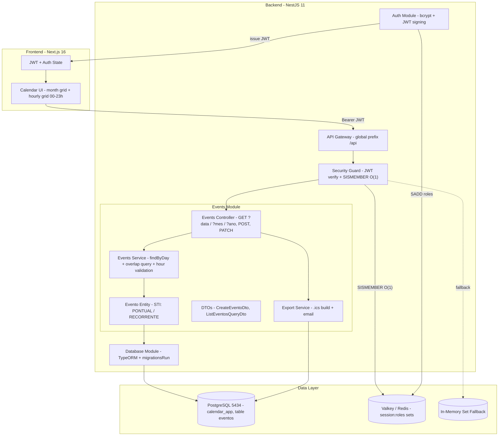
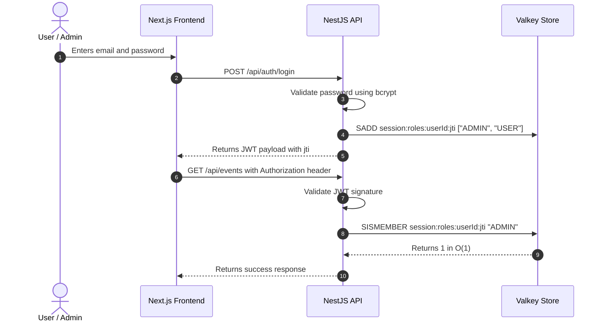

# 📅 Nexus Calendar App

<p align="center">
  
  
  
  
  
</p>

A modern calendar application with secure authentication, RBAC authorization, and high-performance session validation using Valkey sets with O(1) membership checks.

## Overview

This project combines a NestJS API and a Next.js frontend to deliver a secure calendar experience with:

- JWT-based authentication
- role-based authorization (ADMIN vs USER)
- Valkey-backed session role storage using Redis Set semantics
- O(1) permission checks via `SISMEMBER`
- automatic in-memory fallback for resilience
- calendar-focused API and frontend dashboard

## Hourly Grid 00-23h — multiple events per day

The **Events of the Day** sidebar now renders **every hour of the day (00:00-23:00)**. Each hour is an independent clickable slot: clicking it opens the new-event modal pre-filled (e.g. `09:00 -> 10:00`). You can schedule **several events on the same day at different times** — e.g. `09h Meeting`, `12h Lunch`, `18h Gym`.

### How it works

| Item | Behavior |
|---|---|
| Empty slot | Shows `Livre / Free · + agendar` — click creates an event at that hour |
| Occupied slot | Shows `HH:MM-HH:MM Title` — click adds **another** event at the same hour |
| Current hour | When the selected day is today, the current hour is highlighted in blue |
| All day | Events with `diaInteiro=true` appear in a separate section at the top (00:00-23:59) |
| Month grid | Calendar cells show `HH:MM Title` of each event |
| Validation | `dataFim` must be after `dataInicio` (otherwise `400 Bad Request`) |

### Database remodel

The `eventos` table already used full `TIMESTAMP` `data_inicio` / `data_fim` (date **+ time**). The remodel guarantees and speeds up that model:

```sql
-- Migration: 1793979730000-RemodelEventosHorarios (idempotent)
ALTER TABLE "eventos"
  ADD CONSTRAINT "chk_eventos_data_fim_maior_que_inicio"
  CHECK ("data_fim" >= "data_inicio");        -- valid interval

CREATE INDEX "idx_eventos_data_fim"        ON "eventos" ("data_fim");
CREATE INDEX "idx_eventos_usuario_dia"     ON "eventos" ("usuario_id", "data_inicio", "data_fim");
CREATE INDEX "idx_eventos_intervalo"       ON "eventos" ("data_inicio", "data_fim");

-- Normalizes dia_inteiro -> 00:00:00 -> 23:59:59 of the same day
-- Repairs legacy data_fim <= data_inicio (minimum 1h duration)
```

Backend rules (`events.service.ts`):

- **No `UNIQUE` on (user, day)** — multiple events/day is the normal case, not an exception.
- `diaInteiro=true` is normalized server-side to `00:00:00 -> 23:59:59` of the day (local time).
- Day query uses **overlap**: `dataInicio <= fimDia AND dataFim >= inicioDia` (catches events starting/entering the day) ordered by start hour — ideal for the 00->23h grid.

### Events API

```http
GET  /api/events                # all (or ?mes=11&ano=2026)
GET  /api/events?data=2026-11-09 # only the given day (hourly grid)
POST /api/events                # ADMIN — accepts times
```

```jsonc
{
  // "titulo", "dataInicio", "dataFim", "diaInteiro" (hourly grid)
  // "title", "date" (legacy, kept for compatibility)
  "titulo": "Reuniao 09h",
  "dataInicio": "2026-11-09T09:00:00.000Z",
  "dataFim": "2026-11-09T10:00:00.000Z",
  "diaInteiro": false
}
```

> Existing database: `migrationsRun` is on (`DB_MIGRATIONS_RUN=true`) — just start the backend, or run `npm run migration:run` in `backend/`.

## Architecture



## Why the Valkey Set Strategy?

Instead of storing full session objects or JSON blobs in cache, this app stores user role membership in a Valkey Set keyed by session.

- Login adds roles with `SADD`
- Access validation uses `SISMEMBER`
- This makes permission checks effectively constant time: O(1)
- If Valkey becomes unavailable, the app falls back to an in-memory JavaScript `Set`

This is especially useful for fast RBAC checks in authentication workflows and reduced response latency under load.

## Security Model

### OWASP A01:2021 – Broken Access Control

The application implements RBAC with role verification using session-specific Valkey sets.

Rules:

- `USER` can access calendar read operations
- `ADMIN` can access full event management capabilities
- Each JWT includes a unique `jti` session identifier
- Logout invalidates the session set immediately

### OWASP A07:2021 – Identification & Authentication Failures

- JWTs are signed with a secret key
- `jti` is used to uniquely identify a session
- Role access is verified using the current session set
- Revocation is performed by deleting the corresponding set key

## Tech Stack

### Backend
- NestJS 11
- TypeScript
- PostgreSQL 17 (portable, port `5434`, database `calendar_app`) via **TypeORM** (migrations, `synchronize` off by default)
- JWT authentication
- BCrypt password hashing
- Valkey / Redis client (`ioredis`)
- Jest for testing

### Frontend
- Next.js 16
- React 19
- TypeScript
- App Router
- Tailwind CSS
- Lucide icons
- Month grid + sidebar hourly grid 00-23h (`Calendar.tsx`)

## Repository Structure

```bash
calendar-app/
├── backend/
│   ├── src/
│   │   ├── database/
│   │   │   ├── database.module.ts
│   │   │   ├── data-source.ts
│   │   │   └── migrations/
│   │   │       ├── 1793979726572-InitialSchema.ts
│   │   │       └── 1793979730000-RemodelEventosHorarios.ts  # hourly remodel
│   │   └── events/
│   │       ├── entities/evento.entity.ts        # base + CHECK + interval indexes
│   │       ├── events.service.ts                # findByDay() + time validation/normalization
│   │       ├── events.controller.ts             # GET ?data / ?mes / ?ano
│   │       └── dto/                             # CreateEventoDto, ListEventosQueryDto (`data`)
│   ├── test/
│   ├── package.json
│   ├── tsconfig.json
│   └── README.md
├── frontend/
│   ├── src/
│   │   ├── components/Calendar.tsx   # month grid + hourly grid 00-23h
│   │   └── app/globals.css           # theme + custom scrollbar
│   ├── public/
│   ├── package.json
│   ├── next.config.ts
│   └── README.md
├── scripts/
│   ├── start-postgres.ps1
│   └── stop-postgres.ps1
├── README.md
└── .gitignore
```

## Local Development

### 0. Database — PostgreSQL 17 (port 5434)

Portable PostgreSQL 17 (ports 5432/5433 were already taken by Windows services without a known password):

```
C:\Users\Usuario\AppData\Local\Temp\opencode\postgres17\
```

| Field | Value |
|---|---|
| Host | `localhost` |
| Port | `5434` |
| User | `postgres` |
| Password | `postgres` |
| Database | `calendar_app` |

To start/stop:

```powershell
powershell -ExecutionPolicy Bypass -File .\scripts\start-postgres.ps1
powershell -ExecutionPolicy Bypass -File .\scripts\stop-postgres.ps1
```

Check the connection:

```bash
cd backend
node check-db.js
```

> The backend reads these from `backend/.env` (copy `backend/.env.example`).

### 1. Install backend dependencies

```bash
cd backend
npm install
```

### 2. Start the backend

```bash
cd backend
npm run migration:run   # applies the hourly remodel (idempotent, no data loss)
npm run start:dev
```

The API runs at:

- http://localhost:5000/api

> `migrationsRun` is on (`DB_MIGRATIONS_RUN=true`): if you skip the manual step, the migration runs automatically at startup.

### 3. Install frontend dependencies

```bash
cd frontend
npm install
```

### 4. Start the frontend

```bash
cd frontend
npm run dev
```

Then open:

- http://localhost:3000

## Default Test Users

| Profile | Email | Password | Roles |
|---|---|---|---|
| Admin | `admin@calendar.com` | `admin123` | `ADMIN`, `USER` |
| User | `user@calendar.com` | `user123` | `USER` |

## Core Auth Flow



## Testing

Run the backend test suite:

```bash
cd backend
npm test
```

### Quick hourly-grid check (multi-event day)

```bash
# 1. login as ADMIN
curl -s http://localhost:5000/api/auth/login \
  -H 'Content-Type: application/json' \
  -d '{"email":"admin@calendar.com","password":"admin123"}'

# 2. two events on the same day, different times (201 expected)
curl -s -X POST http://localhost:5000/api/events \
  -H "Authorization: Bearer <TOKEN>" -H 'Content-Type: application/json' \
  -d '{"titulo":"Reuniao 09h","dataInicio":"2026-11-09T09:00:00.000Z","dataFim":"2026-11-09T10:00:00.000Z","diaInteiro":false}'

# 3. day filter (hourly grid)
curl -s "http://localhost:5000/api/events?data=2026-11-09" -H "Authorization: Bearer <TOKEN>"
```

## Notes

This application is built as a secure event-calendar prototype focused on authentication patterns, access control, and resilient session validation. The Valkey Set design is the main differentiator: it keeps authorization checks fast and efficient while also providing a graceful fallback path when the cache layer is unavailable.

## License

This project is currently configured for local development and demonstration use.

---

Built with NestJS + Next.js + Valkey for secure, fast calendar access control.
