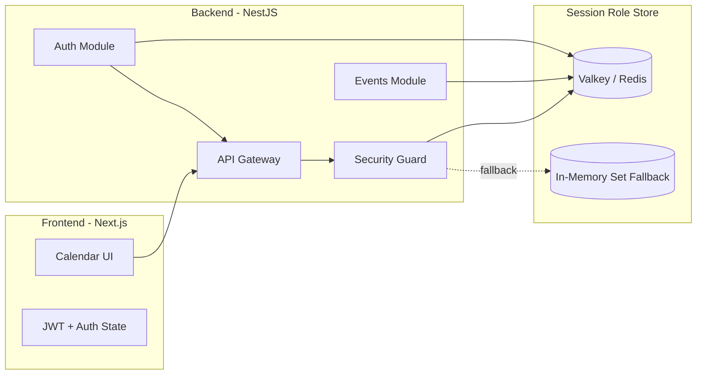
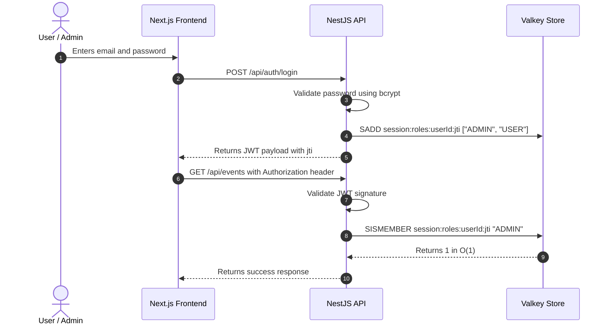

# 📅 Nexus Calendar App

<p align="center">
  
  
  
  
  
</p>

A modern calendar application with secure authentication, RBAC authorization, and high-performance session validation using Valkey sets with O(1) membership checks.

## Overview

This project combines a NestJS API and a Next.js frontend to deliver a secure calendar experience with:

- JWT-based authentication
- role-based authorization (ADMIN vs USER)
- Valkey-backed session role storage using Redis Set semantics
- O(1) permission checks via `SISMEMBER`
- automatic in-memory fallback for resilience
- calendar-focused API and frontend dashboard

## Architecture



## Why the Valkey Set Strategy?

Instead of storing full session objects or JSON blobs in cache, this app stores user role membership in a Valkey Set keyed by session.

- Login adds roles with `SADD`
- Access validation uses `SISMEMBER`
- This makes permission checks effectively constant time: O(1)
- If Valkey becomes unavailable, the app falls back to an in-memory JavaScript `Set`

This is especially useful for fast RBAC checks in authentication workflows and reduced response latency under load.

## Security Model

### OWASP A01:2021 – Broken Access Control

The application implements RBAC with role verification using session-specific Valkey sets.

Rules:

- `USER` can access calendar read operations
- `ADMIN` can access full event management capabilities
- Each JWT includes a unique `jti` session identifier
- Logout invalidates the session set immediately

### OWASP A07:2021 – Identification & Authentication Failures

- JWTs are signed with a secret key
- `jti` is used to uniquely identify a session
- Role access is verified using the current session set
- Revocation is performed by deleting the corresponding set key

## Tech Stack

### Backend
- NestJS 11
- TypeScript
- JWT authentication
- BCrypt password hashing
- Valkey / Redis client (`ioredis`)
- Jest for testing

### Frontend
- Next.js 16
- React 19
- TypeScript
- App Router
- Tailwind CSS
- Lucide icons

## Repository Structure

```bash
calendar-app/
├── backend/
│   ├── src/
│   ├── test/
│   ├── package.json
│   ├── tsconfig.json
│   └── README.md
├── frontend/
│   ├── src/
│   ├── public/
│   ├── package.json
│   ├── next.config.ts
│   └── README.md
├── README.md
└── .gitignore
```

## Local Development

### 1. Install backend dependencies

```bash
cd backend
npm install
```

### 2. Start the backend

```bash
cd backend
npm run start:dev
```

The API runs at:

- http://localhost:5000/api

### 3. Install frontend dependencies

```bash
cd frontend
npm install
```

### 4. Start the frontend

```bash
cd frontend
npm run dev
```

Then open:

- http://localhost:3000

## Default Test Users

| Profile | Email | Password | Roles |
|---|---|---|---|
| Admin | `admin@calendar.com` | `admin123` | `ADMIN`, `USER` |
| User | `user@calendar.com` | `user123` | `USER` |

## Core Auth Flow



## Testing

Run the backend test suite:

```bash
cd backend
npm test
```

## Notes

This application is built as a secure event-calendar prototype focused on authentication patterns, access control, and resilient session validation. The Valkey Set design is the main differentiator: it keeps authorization checks fast and efficient while also providing a graceful fallback path when the cache layer is unavailable.

## License

This project is currently configured for local development and demonstration use.

---

Built with NestJS + Next.js + Valkey for secure, fast calendar access control.
